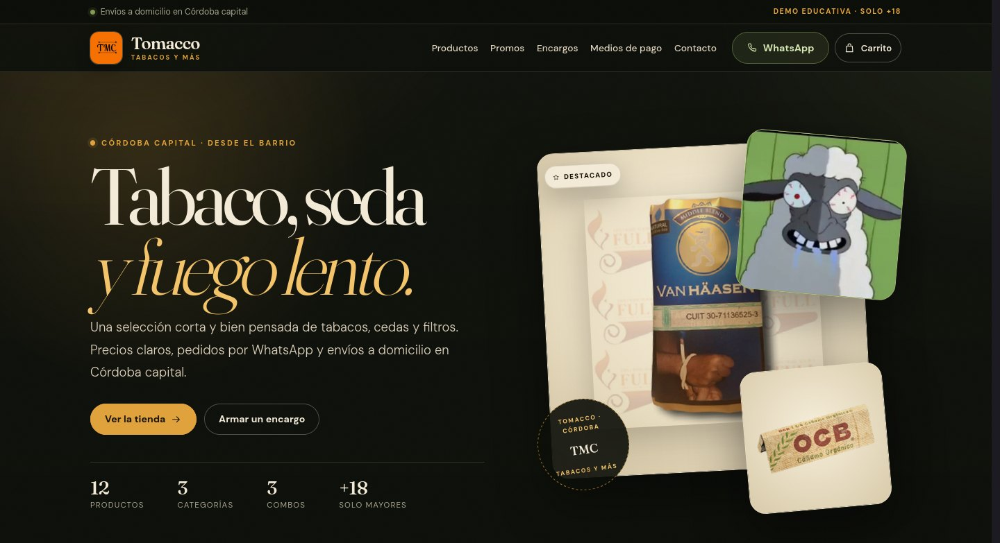

# Tomacco · Tabacos y más

Demo educativa de una tienda de tabacos, cedas y filtros en Córdoba capital. Nació como proyecto de Coderhouse para practicar HTML, CSS y JavaScript, y esta versión es un reestilado completo con carrito, filtros y checkout por WhatsApp.

> **Demo, no producción.** Los precios y combos son los del proyecto original y pueden no estar vigentes. Sitio exclusivo para mayores de 18 años. Fumar es perjudicial para la salud.



## Qué incluye

- **Rediseño visual “tabacalera vintage”**: verde bosque, ámbar y papel crema, tipografías Fraunces + DM Sans y componentes propios sobre Bootstrap restilizado.
- **Bootstrap 5.3.8 y fuentes servidas localmente** en `vendor/` y `assets/fonts/`, sin depender de CDNs.
- **Catálogo interactivo**: búsqueda sin acentos, filtros por categoría, orden por precio/nombre y modal de detalle.
- **Carrito persistente**: agregar, sumar/restar cantidades, quitar, vaciar, total y checkout por WhatsApp. Se guarda en `localStorage`.
- **Promos y combos** que se suman al mismo carrito.
- **Formularios validados** de encargos y contacto, con errores accesibles, contador de caracteres y resumen del pedido.
- **Checkout por WhatsApp**: arma un mensaje con productos, total y datos del cliente.
- **Medios de pago interactivos**: Mercado Pago / efectivo con panel de pasos.
- **Navegación responsive** con menú hamburguesa, panel de carrito, toasts y botón de volver arriba.
- **Accesibilidad**: `lang="es"`, skip link, foco visible, `aria-*`, labels asociados, imágenes con `alt` y respeto por `prefers-reduced-motion`.
- **Tests** de lógica, carrito, validaciones, mensajes de WhatsApp y estructura de las páginas.

## Cómo correrlo

Necesitás Node.js 20 o superior.

```bash
npm install
npm run dev
```

Abrí <http://localhost:4173>.

> Los módulos ES no funcionan si abrís los HTML con doble clic (`file://`). Usá el servidor local; si abrís el archivo directo, la demo muestra un aviso con las instrucciones.

## Scripts

| Comando | Qué hace |
| --- | --- |
| `npm run dev` | Levanta el servidor estático en `http://localhost:4173`. |
| `npm run build:css` | Compila `scss/estilos.scss` a `css/estilos.css`. |
| `npm run watch:css` | Compila SCSS en modo watch. |
| `npm test` | Corre los tests con `node:test`. |
| `npm run test:watch` | Corre los tests en modo watch. |

## Estructura

```text
.
├── index.html                  Home
├── Productos.html              Catálogo
├── Promos.html                 Carousel y combos
├── Encargos.html               Formulario de pedido
├── Contactanos.html            Contacto y FAQ
├── Medios-de-pago.html         Pago interactivo
├── 404.html                    Página no encontrada
├── error404.html               Redirección a 404.html
├── assets/fonts/               Fraunces y DM Sans (woff2)
├── css/estilos.css             CSS compilado
├── img/                        Imágenes del proyecto original
├── js/
│   ├── config.js               WhatsApp, redes y claves de storage
│   ├── main.js                 Entrypoint
│   ├── data/                   Productos y promos
│   ├── lib/                    Lógica pura (carrito, formato, validación…)
│   ├── pages/                  Lógica por página
│   └── ui/                     Shell, carrito, toasts, iconos y cards
├── scss/                       Fuente de estilos
├── scripts/serve.js            Servidor local sin dependencias
├── tests/                      Tests con node:test
└── vendor/bootstrap/           Bootstrap 5.3.8 local
```

## Editar la demo

- **Productos y precios**: `js/data/productos.js`.
- **Promos y combos**: `js/data/promos.js`.
- **WhatsApp, Instagram y Facebook**: `js/config.js`.
- **Colores, tipografías y radios**: `scss/_tokens.scss`.
- **Estilos de componentes**: `scss/_componentes.scss`.
- Después de tocar SCSS: `npm run build:css`.

El carrito se guarda bajo `tomacco:carrito:v1` en `localStorage`. Para limpiarlo, vaciá el carrito desde el panel o borrá esa clave desde las herramientas del navegador.

## Tests

```bash
npm test
```

La suite cubre:

- Formato de precios y normalización de texto.
- Carrito: alta, fusión de duplicados, cantidades, totales, serialización y datos corruptos.
- Filtros, búsqueda y orden del catálogo.
- Validaciones de contacto y encargos.
- Construcción de mensajes y URLs de WhatsApp.
- Estructura de las 7 páginas: IDs duplicados, assets/enlaces rotos, `alt`, `aria-*` y botones de carrito.

También se verificaron en Firefox headless los flujos de filtros, carrito, modal, formularios, checkout, selector de pagos, 404 y menú móvil.

## Deploy

Es un sitio estático. Subí el repositorio (sin `node_modules/`) a GitHub Pages, Netlify, Vercel o cualquier hosting de archivos. Para GitHub Pages, `404.html` se usa automáticamente como página de error.

## Créditos

Proyecto original de **Estanislao** para Coderhouse. Reestilado, interactividad y tests agregados sobre esa base.
